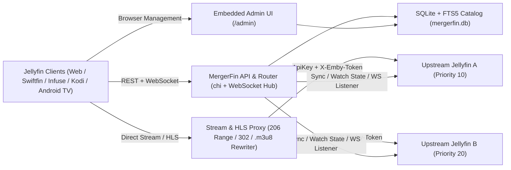

# MergerFin

[](https://github.com/tsrz/mergerfin/actions/workflows/ci.yml)
[](https://ghcr.io/tsrz/mergerfin)
[](go.mod)
[](LICENSE)

**MergerFin** is an open-source unified virtual Jellyfin server — think `mergerfs` for multiple remote Jellyfin servers and user accounts.

Instead of switching between servers inside your media apps or maintaining separate libraries and watch histories, MergerFin aggregates any number of upstream Jellyfin instances into a **single virtual Jellyfin `12.4` / `10.10+` server** with:

- A native **Jellyfin Web UI** served at `/web`
- A built-in, zero-dependency **Admin Portal** at `/admin`
- Unified **Movies** and **TV Shows** libraries with cross-server deduplication
- Native **multi-source version selection** (`MediaSources[]`) in Jellyfin clients
- **Zero-copy Direct Stream** (`206 Partial Content` / `302 Redirect`) and **Dynamic HLS `.m3u8` Proxy**
- **Bidirectional Watch State Sync** and **cross-server Next Up**

---

## Architecture



---

## Key Capabilities

### 1. Entity Deduplication via `ProviderIds`
During catalog synchronization, MergerFin normalizes external provider metadata (`Tmdb`, `Imdb`, `Tvdb`) and computes deterministic canonical keys:
- **Movies**: `movie:tmdb:<id>` -> `movie:imdb:<id>` -> `movie:slug:<slug>:year:<year>`
- **Series**: `series:tmdb:<id>` -> `series:tvdb:<id>` -> `series:imdb:<id>` -> `series:slug:<slug>`
- **Seasons & Episodes**: Resolved under the canonical series key (`season:<seriesKey>:s<n>`, `episode:<seriesKey>:s<n>:e<n>`), allowing seasons and episodes of the same show split across multiple servers to merge seamlessly into one unified series view.

Metadata and artwork are owned by the highest-priority upstream server (lowest priority integer), with missing fields automatically backfilled from secondary servers.

### 2. Native Multi-Server `MediaSources[]` Selector
When the same movie or episode exists on multiple upstream servers (for example, a 4K REMUX on Server A and a 1080p H.264 encode on Server B), MergerFin attaches all sources to the single virtual item. Every source is labeled cleanly:

```text
[Upstream A] 2160p HEVC (25.0 Mbps)
[Upstream B] 1080p H264 (8.0 Mbps)
```

Jellyfin clients display these natively in their **Version** dropdown, and MergerFin's `PlaybackInfo` negotiator fans out in parallel (`4s` timeout) and ranks candidates by requested `MediaSourceId` -> `SupportsDirectPlay` -> `SupportsDirectStream` -> server `Priority` -> `Bitrate`.

### 3. Streaming Modes: `proxy` vs `redirect`
Each upstream server can be configured independently in `/admin`:
- **`proxy` (default)**: MergerFin streams bytes zero-copy from upstream to client with full `Range` / `If-Range` / `206 Partial Content` support, plus dynamic HLS `.m3u8` rewriting (including `#EXT-X-MAP` fMP4 initialization segments) that keeps upstream `ApiKey` credentials completely hidden from clients.
- **`redirect`**: MergerFin issues an `HTTP 302 Found` redirect directly to the upstream server's `/Videos/{id}/stream` endpoint when clients have direct network reachability.

### 4. Bidirectional Watch State Sync & Cross-Server `NextUp`
- Playback start, progress (throttled to `10s` intervals per user/item or immediate on pause/resume), completion (`>= 90%` runtime on stop), played toggles, and favorites are persisted locally in SQLite and fanned out asynchronously to **all** enabled upstream servers owning that item.
- Because episode completion is unified in local SQLite, watching `S01E01` on Upstream A automatically surfaces `S01E02` from Upstream B in `/Shows/NextUp`.
- Upstream `LibraryChanged` and `UserDataChanged` WebSocket events trigger debounced delta syncs and forward real-time updates to connected Jellyfin clients.

---

## Quick Start

### 1. Create `docker-compose.yml`

```yaml
services:
  mergerfin:
    image: ghcr.io/tsrz/mergerfin:latest
    container_name: mergerfin
    restart: unless-stopped
    ports:
      - "${MERGERFIN_HOST_PORT:-8096}:8096"
    volumes:
      - "${MERGERFIN_DATA_DIR:-./data}:/data"
    environment:
      MERGERFIN_PORT: "${MERGERFIN_PORT:-8096}"
      MERGERFIN_DATA_DIR: /data
      MERGERFIN_WEB_DIR: /app/web
      MERGERFIN_SERVER_NAME: "${MERGERFIN_SERVER_NAME:-MergerFin}"
      MERGERFIN_ADMIN_USER: "${MERGERFIN_ADMIN_USER:-admin}"
      MERGERFIN_ADMIN_PASS: "${MERGERFIN_ADMIN_PASS:-change-me}"
      MERGERFIN_SECRET_KEY: "${MERGERFIN_SECRET_KEY:-}"
      MERGERFIN_SYNC_INTERVAL: "${MERGERFIN_SYNC_INTERVAL:-30m}"
      MERGERFIN_LOG_LEVEL: "${MERGERFIN_LOG_LEVEL:-info}"
    healthcheck:
      test: ["CMD-SHELL", "wget -qO- http://127.0.0.1:8096/System/Info/Public >/dev/null || exit 1"]
      interval: 30s
      timeout: 5s
      retries: 3
      start_period: 10s
```

Start the container:

```bash
docker compose up -d
```

### 2. Configure Upstream Servers in `/admin`
1. Open **`http://localhost:8096/admin`** in your browser and sign in with `MERGERFIN_ADMIN_USER` / `MERGERFIN_ADMIN_PASS`.
2. Click **+ Add Server**, enter your upstream Jellyfin URL, credentials, **Priority** (lower number = higher priority), and **Stream Mode** (`proxy` or `redirect`).
3. Click **Test Connection** to verify reachability, latency, and Jellyfin version, then save.
4. Click **Sync Now** in the top bar to index your unified catalog.

### 3. Connect Your Jellyfin Client
Open **`http://localhost:8096/web`** (or point any Jellyfin app to `http://<your-host>:8096`) and log in with any local proxy user configured in `/admin`.

---

## Configuration (`MERGERFIN_*`)

| Environment Variable | Default | Description |
| --- | --- | --- |
| `MERGERFIN_PORT` | `8096` | Internal HTTP listen port (also configurable via `-port`). |
| `MERGERFIN_HOST_PORT` | `8096` | Host port mapped by `docker-compose.yml` (compose / `.env` variable). |
| `MERGERFIN_DATA_DIR` | `./data` (`/data` in Docker) | Directory storing SQLite (`mergerfin.db`) and image cache (`cache/images`). Also `-data-dir`. |
| `MERGERFIN_WEB_DIR` | `/app/web` | Directory containing `jellyfin-web` static assets (also `-web-dir`). |
| `MERGERFIN_SERVER_NAME` | `MergerFin` | Display server name returned by `/System/Info/Public` and Jellyfin clients. |
| `MERGERFIN_ADMIN_USER` | `admin` | Initial administrator username created on first startup if missing. |
| `MERGERFIN_ADMIN_PASS` | `admin` (`change-me` in `.env.example`) | Initial administrator password created on first startup. |
| `MERGERFIN_SECRET_KEY` | `""` (empty) | Passphrase used with `encryption_salt` (PBKDF2-SHA256) to AES-256-GCM encrypt stored upstream tokens. |
| `MERGERFIN_SYNC_INTERVAL` | `30m` | Periodic background sync interval (Go duration like `30m`, `1h`, or integer minutes). |
| `MERGERFIN_LOG_LEVEL` | `info` | Structured log level (`debug`, `info`, `warn`, `error`). |

---

## Client Compatibility

MergerFin enforces Jellyfin `12.4.0` protocol invariants across all responses:
- **Deterministic 32-char lowercase hex UUIDv5 IDs** (no hyphens) while accepting both 32-hex and 36-char hyphenated UUIDs on incoming routes and query parameters.
- **Outer `/emby` and `/mediabrowser` prefix stripping** (case-insensitive) for legacy Emby/Kodi clients.
- **Multi-format auth extraction** (`Authorization: MediaBrowser/Emby`, `X-Emby-Authorization`, `X-Emby-Token`, `X-MediaBrowser-Token`, `Authorization: Bearer`, `?api_key=`, `?ApiKey=`).

| Client | Status | Notes |
| --- | --- | --- |
| **jellyfin-web** | Supported | Bundled at `/web` with `multiserver: false`. |
| **Jellyfin Desktop / Media Player** | Supported | Full WebSocket keep-alive, `PlaybackInfo`, and version picker. |
| **Swiftfin** | Supported | Native 32-hex IDs, non-null DTO arrays/maps, HLS & direct play. |
| **Infuse** | Supported | Supports `MediaSources[]`, `Range` byte serving, and `ApiKey` auth. |
| **Streamyfin** | Supported | Full catalog, search (FTS5), resume, and playstate reporting. |
| **Findroid** | Supported | Multi-source selection, `/Items/Latest`, `/Shows/NextUp`. |
| **Kodi (Jellyfin for Kodi)** | Supported | Case-insensitive `/emby` prefix stripping and WebSocket events. |
| **Android TV** | Supported | Native `BaseItemDto`, `/Playback/BitrateTest`, and HLS transcoding proxy. |

---

## License

MergerFin is licensed under the **GNU General Public License v3.0 (GPL-3.0)**. See [LICENSE](LICENSE) for full details.
